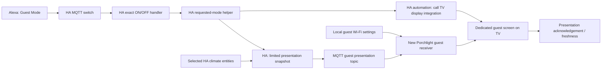

# Guest mode workstream

Status: **staged, not deployed**. Prepared 2026-10-17 from `main` at
`bb34c44d4081bf446aa4412c2971454a121d4457` (v2.4.0). Resume integration when
MacbookPro is available. This change adds a design and configuration starter;
the appliance receiver, guest screen, and automation wiring to the Home Assistant
TV display integration remain to be implemented.

## Intended experience

“Alexa, turn on Guest Mode” activates a Home Assistant switch. The triggered
Home Assistant automation calls the TV display integration to turn on the Vizio
TV and show a Porchlight welcome screen containing:

- A scannable guest Wi-Fi connection QR code, network name, and manual join help.
- Short, verified Alexa examples for the actual lights and music devices.
- Each selected HVAC zone's current temperature, target setpoint or low/high
  range, mode, operating action, and freshness. HVAC is read-only in this feature.

**Confirmed display path:** Alexa → Home Assistant guest-mode automation →
Home Assistant TV display integration → Porchlight guest screen on the TV.
The display path is decided. When MacbookPro returns, inspect the integration's
actual entity/target, action, and required guest-view parameters to wire the call.

“Alexa, turn off Guest Mode” hides the guest content. The initial policy leaves
the TV powered on and returns its guest presenter to a neutral screen. Powering
off the TV, restoring its previous input, or changing HVAC settings are separate
opt-in policies. Repeated ON/OFF commands must be idempotent.

## What is already here

The deployed appliance is the Python/static-web application in this repository.
`azide0x37/porchlight-dashboard` is a separate Next.js design source; changing
that repository alone will not update the appliance screen.

| Existing code | Implication for this feature |
| --- | --- |
| `src/porchlight-ha-mqtt-bridge` | Publishes MQTT discovery and state, but `process_controls()` reads local `.cmd` files. There is no MQTT subscription or network-to-file adapter in this checkout. Publishing a new command topic alone will not implement control. |
| `systemd/porchlight-ha-mqtt-bridge.timer` | Runs about once per minute; unsuitable as the only interactive guest-mode transport. |
| `src/porchlight/webroot/app.js` | Loads the LAN inventory and refreshes every minute. A guest screen needs a separate, limited data path and faster mode changes. |
| `src/porchlight/web.py` | Serves the dashboard, static files and setup APIs. Hiding navigation is not access control for these endpoints. |
| `src/porchlight/render.py` | Rewrites scanner JSON and copies web assets. Guest state must not be overwritten by a scanner render. |
| `bin/install.sh`, `bin/update.sh`, `bin/uninstall.sh` | Preserve `/etc/porchlight` settings. Guest configuration must follow the same lifecycle. |

## Ownership and transport



Home Assistant owns requested mode, TV actions, and HVAC truth. Porchlight owns
guest content, local QR generation, and presentation status. The starter adds
one MQTT switch to the existing Porchlight device using the same MQTT device
identifier (`porchlight` by default). Do not create a second scanner device.
Keep this switch defined in one place: do not also add a discovery component
with the same unique ID while the YAML entity is installed.

The switch reports **requested** mode; it is not proof the TV is displaying the
screen. Add a separate diagnostic status for `starting`, `active`, `degraded`,
`off`, or `unavailable`. `active` requires a current browser/presenter heartbeat,
not just a successful MQTT publish or a TV power-on state. Tie acknowledgements
to the current mode session so an old acknowledgement cannot mark a new session
active. Surface TV wake, HA display-integration, and Porchlight errors independently.

### Proposed MQTT contract

All topics below use the default `HA_BASE_TOPIC=porchlight`. Replace the prefix
consistently for an existing installation. Use authenticated broker connections
and scoped ACLs; keep credentials in the existing local configuration mechanism.

| Topic | Writer → reader | Payload / retention |
| --- | --- | --- |
| `porchlight/cmd/guest_mode/set` | HA switch → HA automation | Exact `ON` or `OFF`; QoS 1, **not retained**. Reject all other payloads. |
| `porchlight/guest/requested` | HA → switch | `ON` / `OFF`; retained. This is UI state, never a replayable TV command. |
| `porchlight/guest/presentation` | HA → new Porchlight receiver | Versioned JSON, non-retained; changes plus heartbeat every 15 seconds. No Wi-Fi password or arbitrary entity dump. |
| `porchlight/guest/controller/availability` | HA → switch | Commissioned `online` / `offline`; retained, combined with HA's MQTT birth/will topic. |
| `porchlight/guest/availability` | Porchlight receiver → switch | `online` after receiver/config initialization; retained Last Will `offline`. Not emitted by the current bridge. |
| `porchlight/guest/status` | Porchlight → HA diagnostics | Session-correlated applied/presentation state, freshness, bounded error codes; no credentials. To implement. |

The receiver accepts only the presentation schema. It does not execute service
names, URLs, commands, or shell fragments from MQTT. It must reject malformed,
oversized, future-dated, and expired messages; validate actual numeric values
and units; and apply the newest valid state atomically. Limit payloads to 16 KiB.
Use a monotonic local receipt deadline as well as the sender timestamp. After
45 seconds without a valid heartbeat, hide the QR and mark HVAC unavailable.
The browser must also enforce freshness if its connection to Porchlight drops.

An OFF state must clear visible credentials promptly even if the TV integration
fails. Never queue a delayed TV wake for a stale session. A Porchlight reconnect
may recover the current guest display from the next live snapshot, but must not
power-cycle the TV. Home Assistant restart defaults mode and commissioning to
OFF in the starter, avoiding an unexpected wake or credential display.

## Guest content and screen

The local configuration example is
[`porchlight-guest.example.json`](../../examples/guest-mode/porchlight-guest.example.json).
It is proposed input for the new feature, not a format supported by v2.4.0.
Store the real configuration outside the checkout under `/etc/porchlight`, with
access limited to the service and administrator. The Wi-Fi password is for a
guest network and is supplied locally; do not infer it from appliance setup
Wi-Fi, commit it, or send it to a QR web service.

Generate the Wi-Fi QR locally using a maintained, bundled library. Encode the
standard `WIFI:T:WPA;S:<escaped ssid>;P:<escaped password>;H:false;;` form, with
correct escaping of backslashes, semicolons, commas, colons, and quotes. Handle
open networks explicitly. Test Android and iOS, special characters, Unicode,
hidden SSIDs, and the actual network's security mode. A QR contains the Wi-Fi
secret, so give QR responses `no-store` too (the current server caches SVG/PNG).

Use a dedicated `/guest/` presentation surface with a guest-only data endpoint.
The TV view should not load `hosts.json`, `snapshot.json`, setup APIs, network
inventory, or administrator navigation. Before serving real content, implement
and test a guest access boundary: a dedicated restricted listener or equivalent
route authorization allowing only guest assets/data. An isolated TV route must
not become a route to the unrestricted admin listener. Keep the public demo
strictly synthetic. Do not treat the current unauthenticated LAN web service as
safe to publish on the Internet or guest network merely because the UI is hidden.

At 1920×1080, reserve a large high-contrast QR area, show 2–3 short voice examples
per category, and use readable temperature cards. Allow 5% overscan margins;
check at 1280×720 too. Use plain text insertion for configured labels/commands.
No scrolling should be needed for the configured household. Blank unavailable
measurements rather than turning null/unknown into zero. Show `°F` or `°C` from
the HA unit system and support `temperature`, `target_temp_low`, and
`target_temp_high` separately. Mode (for example heat/cool) and action (for
example heating/idle) are different fields.

## Implementation sequence and gates

- [x] Inspect current appliance architecture and identify missing MQTT receiver.
- [x] Stage HA switch/automation starter, local content example, and sample data.
- [x] Confirm that the Alexa-triggered HA automation calls the HA TV display integration.
- [ ] **G0 — inventory on MacbookPro.** Find the actual checkout, read its current
  `AGENTS.md`, preserve dirty work, compare with this branch, and confirm the
  running Porchlight version, HA version, MQTT base topic/node ID/birth-will
  settings, TV display integration target/action, climate entities, and Alexa
  exposure method.
- [ ] **G1 — receiver and state.** Build a systemd-owned subscriber with explicit
  topics, reconnect/backoff, Last Will, schema validation, bounded atomic state
  writes, expiry, and session-aware status. Add mocks for disconnect, invalid
  JSON, retained/stale state, rapid ON→OFF, and duplicate commands. No TV service
  calls belong in the appliance subscriber.
- [ ] **G2 — guest feature.** Add protected local configuration, local QR
  generation, dedicated guest page/data access, freshness handling, a browser
  heartbeat, and inactive view. Verify scanner renders cannot clobber its state.
- [ ] **G3 — HA/TV integration.** Adapt the starter to the real HA version and
  entities; wire the Alexa-triggered automation to the HA TV display integration
  with its required guest-view parameters. Confirm bounded wake/display retries
  and cancellation after OFF. Validate config in HA before loading it. Keep the
  commissioning gate OFF until G1–G3 have been verified.
- [ ] **G4 — Alexa and household acceptance.** Expose only the guest-mode switch
  with Alexa name `Guest Mode` using the existing HA Cloud or manual Smart Home
  integration. Do not expose commissioning/helpers/scanner controls. Discover
  devices and verify the actual voice commands and music destination.
- [ ] **G5 — package and rollout.** Add lifecycle handling and tests, update the
  README self-certification table and applicable Muster mapping, run `make test`
  and `make package`, review the change, and perform the normal release/install.
  Record versions and acceptance evidence before marking the feature complete.

### Resume checklist

Fetch the staged branch into an isolated worktree after inspecting local work:

```sh
git fetch origin workstream/guest-mode
git worktree add ../porchlight-guest-mode origin/workstream/guest-mode
```

Record these installation-specific values locally, not in a public PR:

| Required value | How to resolve |
| --- | --- |
| Vizio media-player entity and network wake | Test HA integration; Vizio documentation requires Quick Start rather than Eco Mode for network power-on. Confirm this model supports it. |
| HA TV display integration call | The display path is confirmed. Inspect the configured integration's entity/target, action, and guest-view parameters; invoke it from the Alexa-triggered HA automation and verify the guest screen appears. |
| HVAC entities and units | Inspect selected `climate.*` states/attributes and the HA unit system. Start with one zone, then expand the projection explicitly. |
| Guest SSID/security/password | Enter locally from the guest-network settings. Keep out of issues, logs, screenshots, demos, and Git. |
| Alexa lights/music names | Test each phrase against the actual Echo/group configuration. The example phrases are unverified placeholders. |
| Alexa integration | Reuse the existing HA Cloud or manual Smart Home setup; no new cloud subscription is assumed. |

Resume prompt: “Continue the guest-mode workstream in
`docs/workstreams/guest-mode.md`. Inspect local changes and actual HA/Porchlight
configuration first. The Alexa-triggered automation will call the Home Assistant
TV display integration; inspect its target/action and guest-view parameters.
Complete G0, then implement G1–G5 using the staged contract. The starter is not
deployed, its HA TV display call is not yet wired, and no real guest credentials
have been collected.” This document does not create an automatic watcher or
scheduled resume task.

### Acceptance matrix

| Scenario | Required observation |
| --- | --- |
| Alexa ON with TV off | The HA automation calls the TV display integration; one TV wake, current guest page and scannable Wi-Fi QR. Target: visible within 30 seconds; set the final budget after measuring the hardware. |
| Alexa ON with TV already on / repeated ON | Same requested state; no repeated display calls, wake loop, or new session. |
| Alexa OFF during TV startup | Pending activation is cancelled; QR clears; no delayed wake/display call. |
| Two setpoint types | Single target and low/high range display correctly with units, current temperature, mode and action. |
| HA/Porchlight/MQTT outage | Unavailable diagnostic; QR hidden at expiry; HVAC marked unavailable, never falsely current. |
| Malformed or stale MQTT message | Rejected; does not extend the last valid state's lifetime. |
| Restart / reconnect | HA restart defaults OFF; reconnect cannot replay a TV wake; fresh state rehydrates only the presentation. |
| Guest content access | Inactive screen and expired/unauthorized guest requests cannot return credentials or reach admin APIs. No secret appears in logs, retained MQTT, analytics, or scanner snapshots. |
| QR / voice instructions | Real iOS and Android join test; household-approved Alexa light/music phrases work. |
| Exit | Guest information disappears, TV follows documented exit policy, HVAC settings remain unchanged. |

Rollback: turn guest mode OFF, disable its HA automations/Alexa exposure, stop
the new guest receiver/presenter, and remove only this feature's retained MQTT
state/discovery if applicable. Preserve existing scanner topics, configuration,
and the shared Porchlight device. Restore the prior release using the repository's
normal update procedure; preserve local guest configuration unless explicitly purged.

## Starter validation

The starter is outside `src/`, `etc/`, and `systemd/`, and is not installed or
included by the current release Makefile. Syntax/template checks do not prove
Home Assistant runtime compatibility or hardware behavior. Record actual checks
in the staging PR; all G0–G5 live checks remain outstanding until performed.

References: [HA MQTT switch](https://www.home-assistant.io/integrations/switch.mqtt/),
[HA Alexa Smart Home](https://www.home-assistant.io/integrations/alexa.smart_home/),
[HA Vizio](https://www.home-assistant.io/integrations/vizio/).
